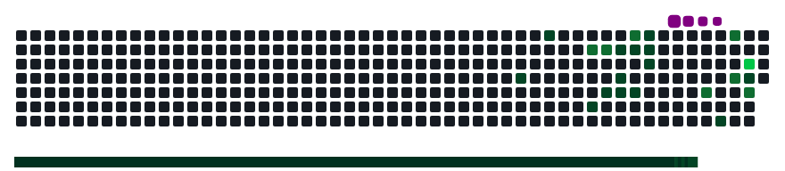

<!-- ══════════════════════════════════════════════════════════ -->
<!--                     WAVE HEADER                          -->
<!-- ══════════════════════════════════════════════════════════ -->


<!-- ══════════════════════════════════════════════════════════ -->
<!--                    TYPING TAGLINE                         -->
<!-- ══════════════════════════════════════════════════════════ -->
<div align="center">

<a href="https://git.io/typing-svg">
  
</a>

<br/>

<!-- Profile View + Social Badges -->

<a href="https://github.com/Imaya-thillai"></a>

<br/><br/>

<a href="mailto:imayathillai20@gmail.com"></a>&nbsp;
<a href="https://linkedin.com/in/imayathillai"></a>&nbsp;
<a href="https://github.com/Imaya-thillai"></a>

</div>

<br/>

---

<!-- ══════════════════════════════════════════════════════════ -->
<!--               ABOUT ME  +  ANIME GIF                     -->
<!-- ══════════════════════════════════════════════════════════ -->
## 🙋‍♀️ About Me


```typescript
const imaya = {
  name      : "Imaya Thillai S",
  role      : "Full-Stack Developer & ML Engineer",
  college   : "SCAD College of Engineering (2023–2027)",
  location  : "Tirunelveli, Tamil Nadu 🇮🇳",
  pronouns  : "She / Her 👩‍💻",
  certified : "AWS ML Engineer Associate 🏆",
  languages : ["Python", "JavaScript", "TypeScript", "Java"],
  stack     : ["Next.js", "React", "Node.js", "FastAPI", "Flask"],
  cloud     : ["AWS S3", "EC2", "SageMaker", "MLOps"],
  currently : "Building ML-powered web apps & exploring GenAI ✨",
  openSource: ["GSSoC Contributor 🌟", "ESSoc Contributor 🌟"],
  funFact   : "I build things that SHIP, not just for demos! 🚀",
};
```

<br/>

- 🔭 I build **end-to-end ML-powered web apps** from Next.js frontends to Python ML backends.
- ☁️ Hands-on **AWS** experience — S3, EC2, SageMaker, MLOps, and cloud-integrated deployments.
- 🏅 **Hackathon Winner** — AFH × Logitech (Zonal 🥇), ISRO Bharatiya Antariksh 🚀, ET AI Hackathon 🤖, IBM watsonx 💡 & more!
- 🌍 **Open Source Contributor** — GSSoC & ESSoc.
- 💬 Ask me about **Full-Stack Architecture**, **ML Pipelines**, or **AWS Cloud**.

<br clear="right"/>

---

<!-- ══════════════════════════════════════════════════════════ -->
<!--             LANGUAGES & TOOLS  (skillicons.dev)          -->
<!-- ══════════════════════════════════════════════════════════ -->
## 🛠️ Languages and Tools

<h4>💻 Programming Languages</h4>
<p align="left">
  
</p>

<h4>⚡ Frameworks & Libraries</h4>
<p align="left">
  
</p>

<h4>🗄️ Databases & ORM</h4>
<p align="left">
  
</p>

<h4>☁️ Cloud, DevOps & Tools</h4>
<p align="left">
  
</p>

<h4>🤖 ML & Data Science</h4>
<p align="left">
  
  &nbsp;
  &nbsp;
  &nbsp;
  &nbsp;
</p>

---

<!-- ══════════════════════════════════════════════════════════ -->
<!--                  FEATURED PROJECTS                        -->
<!-- ══════════════════════════════════════════════════════════ -->
## 🚀 Featured Projects

<div align="center">

| 🏗️ Project | 📋 Description | 🛠️ Tech Stack |
|:-----------|:--------------|:-------------|
| [**🛒 Amazon Market Gap Detector**](https://github.com/Imaya-thillai/amazon-market-gap-detector) | ML-powered market analysis using live Amazon data via RapidAPI. Predicts business opportunities using TF-IDF similarity, VADER sentiment & weighted scoring algorithm. | `FastAPI` `React` `Python` `TF-IDF` `scikit-learn` |
| [**😀 EmojiLang**](https://emoji-lang.vercel.app) | Emoji-Based Programming Language Interpreter — Microsoft Agents League Hackathon 2026. Live on Vercel. | `Node.js` `Custom Interpreter` `Vercel` |
| [**🗺️ PathFinder**](https://github.com/Imaya-thillai) | Route Optimization & Visualization using OpenStreetMap. Implemented A*, Dijkstra's, and BFS algorithms with live route visualization. | `Python` `DSA` `Maps API` |
| [**🗳️ Digital-Civic**](https://github.com/Imaya-thillai/Digital-Civic) | Role-based civic engagement platform with secure JWT auth, real-time voting & optimized PostgreSQL database. Built at Infosys Springboard. | `Next.js` `PostgreSQL` `Prisma` `JWT` |

</div>

---

<!-- ══════════════════════════════════════════════════════════ -->
<!--                   POPULAR REPOS                           -->
<!-- ══════════════════════════════════════════════════════════ -->
## 📌 Popular Repositories

<div align="center">

<a href="https://github.com/Imaya-thillai/amazon-market-gap-detector">
  
</a>
<a href="https://github.com/Imaya-thillai/Digital-Civic">
  
</a>

</div>

---

<!-- ══════════════════════════════════════════════════════════ -->
<!--                   EXPERIENCE                              -->
<!-- ══════════════════════════════════════════════════════════ -->
## 💼 Professional Experience

<table width="100%">
<tr>
<td width="50%" valign="top">

### 🏢 Infosys Springboard
**Web Developer Intern** &nbsp;|&nbsp; `Nov 2025 – Jan 2026`
- ✅ Built a role-based civic engagement platform with secure auth & real-time voting
- ✅ Participated in agile debugging, testing & performance optimization
- ✅ Improved code quality through team-based code reviews

</td>
<td width="50%" valign="top">

### 🏢 Digisailor
**Full Stack Developer Intern** &nbsp;|&nbsp; `Jan 2025 – Feb 2025`
- ✅ Built full webpages using **Next.js**, HTML, CSS, JS
- ✅ Created backend integrations using **Prisma** and **PostgreSQL**
- ✅ Developed responsive UI components per client requirements

</td>
</tr>
</table>

---

<!-- ══════════════════════════════════════════════════════════ -->
<!--                   ACHIEVEMENTS                            -->
<!-- ══════════════════════════════════════════════════════════ -->
## 🏆 Achievements & Certifications

<div align="center">
  
</div>

<br/>

<div align="center">

| 🏅 Achievement | 🏢 Organization | 📅 Year |
|:--------------|:---------------|:-------:|
| 🥇 Zonal Winner — Women Who Master Hackathon | AFH × Logitech | 2026 |
| 🚀 Bharatiya Antariksh Hackathon Participant | ISRO | 2026 |
| 🤖 ET AI Hackathon — Think AI. Build with GenAI | The Economic Times | 2026 |
| 💡 IBM watsonx AI Challenge | IBM | 2026 |
| 🌐 AWS PartyRock AI Builder | Amazon Web Services | 2026 |
| 🎯 Hack2Skill Hackathon Participant | Hack2Skill | 2026 |
| 🌍 GSSoC Open Source Contributor | GirlScript Foundation | 2026 |
| ⭐ ECSoC & ESoC Contributor | Elite Coders | 2026 |
| 🛡️ Wireshark Network Analysis | Geeks2Code × Wireshark | 2026 |

</div>

---

<!-- ══════════════════════════════════════════════════════════ -->
<!--                  GITHUB STATS                             -->
<!-- ══════════════════════════════════════════════════════════ -->
## 📊 GitHub Stats & Metrics

<p align="center">
  
  &nbsp;
  
</p>

<p align="center">
  
</p>

<p align="center">
  
</p>

---

<!-- ══════════════════════════════════════════════════════════ -->
<!--               CONTRIBUTION GRAPH                          -->
<!-- ══════════════════════════════════════════════════════════ -->
## 📈 Contribution Graph

<p align="center">
  
</p>

---

<!-- ══════════════════════════════════════════════════════════ -->
<!--                  SNAKE GAME                               -->
<!-- ══════════════════════════════════════════════════════════ -->
## 🐍 Contribution Snake

<p align="center">
  
</p>

> 🐍 *Snake munching through all my GitHub contributions!*

---

<!-- ══════════════════════════════════════════════════════════ -->
<!--                    FOOTER                                 -->
<!-- ══════════════════════════════════════════════════════════ -->
<div align="center">

### 💌 Let's Connect & Build Together!

<a href="mailto:imayathillai20@gmail.com"></a>&nbsp;
<a href="https://linkedin.com/in/imayathillai"></a>&nbsp;
<a href="https://github.com/Imaya-thillai"></a>

<br/>

⭐️ *From [Imaya-thillai](https://github.com/Imaya-thillai) with 💙*

</div>


