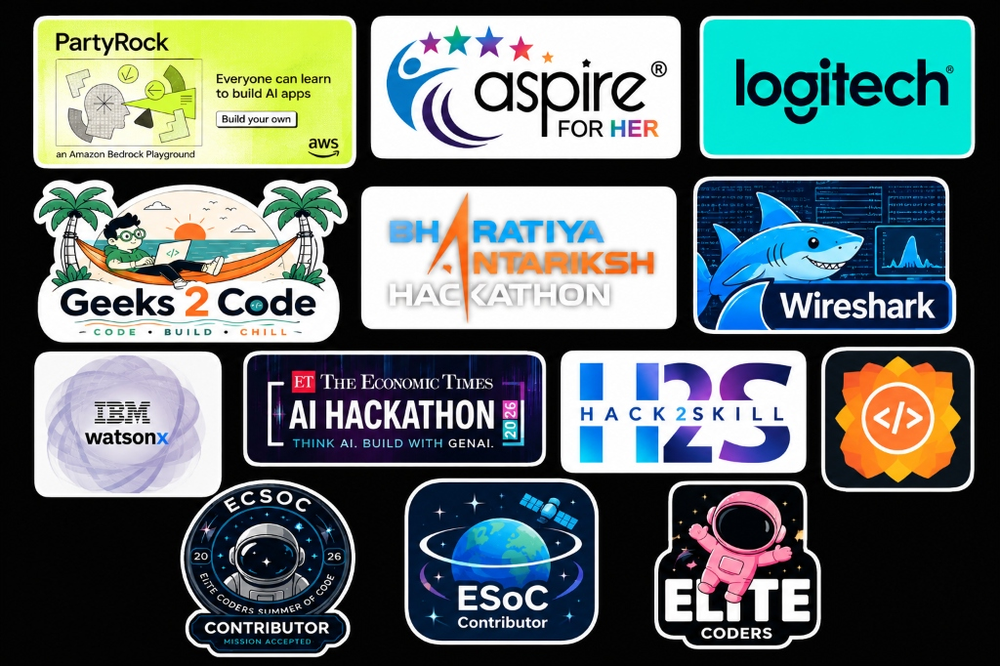

<!-- ══════════════════════════════════════════════════════════ -->
<!--                     WAVE HEADER                          -->
<!-- ══════════════════════════════════════════════════════════ -->

<!-- ══════════════════════════════════════════════════════════ -->
<!--                   SOCIAL BADGES                           -->
<!-- ══════════════════════════════════════════════════════════ -->

  &nbsp;
  &nbsp;
  

---

<!-- ══════════════════════════════════════════════════════════ -->
<!--                ABOUT ME  +  ANIME GIF                    -->
<!-- ══════════════════════════════════════════════════════════ -->
## 👩‍💻 About Me

🎓 **B.E. Computer Science Engineering** — SCAD College of Engineering & Technology *(2023 – 2027)*

🌍 Based in **Tirunelveli, Tamil Nadu, India**

💼 Former intern at **Infosys Springboard** & **Digisailor** — building full-stack civic tech and enterprise web platforms.

🤖 Passionate about **Machine Learning**, **NLP**, and **cloud-integrated** production systems on **AWS**.

🏆 **AWS Machine Learning Engineer Associate** certified.

🥇 Hackathon winner across **AFH × Logitech**, **ISRO Bharatiya Antariksh**, **ET AI Hackathon**, **IBM watsonx** and more.

🌟 Active **Open Source contributor** — GSSoC & ESSoc.

🚀 I build things that **actually ship** — from ML-powered market detectors to civic engagement platforms.

📬 Always open to collaboration, internships, and exciting opportunities!

 

---

<!-- ══════════════════════════════════════════════════════════ -->
<!--          🛠️ LANGUAGES & TOOLS  (skillicons.dev style)    -->
<!-- ══════════════════════════════════════════════════════════ -->
## 🛠️ Languages and Tools

<h4>👨‍💻 Programming Languages</h4>

  

<h4>⚡ Frameworks & Libraries</h4>

  

<h4>🗄️ Databases & ORM</h4>

  

<h4>☁️ Cloud & DevOps</h4>

  

<h4>🔧 Tools & Editors</h4>

  

<h4>🤖 ML & Data Science</h4>

  
  &nbsp;&nbsp;
  
  
  

---

<!-- ══════════════════════════════════════════════════════════ -->
<!--               FEATURED PROJECTS                           -->
<!-- ══════════════════════════════════════════════════════════ -->
## 🚀 Featured Projects

| 🏗️ Project | 📋 Description | 🛠️ Stack |
|:-----------|:--------------|:---------|
| [**🛒 Amazon Market Gap Detector**](https://github.com/Imaya-thillai/amazon-market-gap-detector) | ML-powered market analysis using live Amazon data via RapidAPI. Predicts business opportunities using TF-IDF similarity, VADER sentiment & weighted scoring. | `FastAPI` `React` `Python` `TF-IDF` `scikit-learn` |
| [**😀 EmojiLang**](https://emoji-lang.vercel.app) | Emoji-Based Programming Language Interpreter — Microsoft Agents League Hackathon 2026. Live on Vercel. | `Node.js` `Custom Interpreter` `Vercel` |
| [**🗺️ PathFinder**](https://github.com/Imaya-thillai) | Route Optimization using OpenStreetMap. Implements A*, Dijkstra's, and BFS algorithms with live route visualization. | `Python` `DSA` `Maps API` |
| [**🗳️ Digital-Civic**](https://github.com/Imaya-thillai/Digital-Civic) | Role-based civic engagement platform with secure JWT auth, real-time voting & optimized PostgreSQL database. | `Next.js` `PostgreSQL` `Prisma` `JWT` |

---

<!-- ══════════════════════════════════════════════════════════ -->
<!--              POPULAR REPOSITORIES                         -->
<!-- ══════════════════════════════════════════════════════════ -->
## 📌 Popular Repositories

  
  

---

<!-- ══════════════════════════════════════════════════════════ -->
<!--               PROFESSIONAL EXPERIENCE                     -->
<!-- ══════════════════════════════════════════════════════════ -->
## 💼 Professional Experience

<table width="100%">
<tr>
<td width="50%" valign="top">

### 🏢 Infosys Springboard
**Web Developer Intern** &nbsp;|&nbsp; `Nov 2025 – Jan 2026`
- ✅ Built a role-based civic engagement platform with secure auth & real-time voting
- ✅ Participated in agile debugging, testing & performance optimization
- ✅ Improved code quality through collaborative code reviews

</td>
<td width="50%" valign="top">

### 🏢 Digisailor
**Full Stack Developer Intern** &nbsp;|&nbsp; `Jan 2025 – Feb 2025`
- ✅ Built full webpages using **Next.js**, HTML, CSS, JS
- ✅ Created backend integrations using **Prisma** & **PostgreSQL**
- ✅ Developed responsive UI components per client requirements

</td>
</tr>
</table>

---

<!-- ══════════════════════════════════════════════════════════ -->
<!--                    ACHIEVEMENTS                           -->
<!-- ══════════════════════════════════════════════════════════ -->
## 🏆 Achievements & Certifications

  

| 🏅 Achievement | 🏢 Organization | 📅 Year |
|:--------------|:---------------|:-------:|
| 🥇 Zonal Winner — Women Who Master Hackathon | AFH × Logitech | 2026 |
| 🚀 Bharatiya Antariksh Hackathon Participant | ISRO | 2026 |
| 🤖 ET AI Hackathon — Think AI. Build with GenAI | The Economic Times | 2026 |
| 💡 IBM watsonx AI Challenge | IBM | 2026 |
| 🌐 AWS PartyRock AI Builder | Amazon Web Services | 2026 |
| 🎯 Hack2Skill Hackathon Participant | Hack2Skill | 2026 |
| 🌍 GSSoC Open Source Contributor | GirlScript Foundation | 2026 |
| ⭐ ECSoC & ESoC Contributor | Elite Coders | 2026 |
| 🛡️ Wireshark Network Analysis | Geeks2Code × Wireshark | 2026 |

---

<!-- ══════════════════════════════════════════════════════════ -->
<!--              📊 STATS AND ACTIVITY                        -->
<!-- ══════════════════════════════════════════════════════════ -->
## 📊 Stats and Activity

  

  

<!-- Computer / Coding Activity Graph GIF -->

  

  

---

<!-- ══════════════════════════════════════════════════════════ -->
<!--                      FOOTER                               -->
<!-- ══════════════════════════════════════════════════════════ -->

### 💌 Let's Connect & Build Together!

&nbsp;
&nbsp;

 

⭐️ *From [Imaya-thillai](https://github.com/Imaya-thillai) with 💙*

